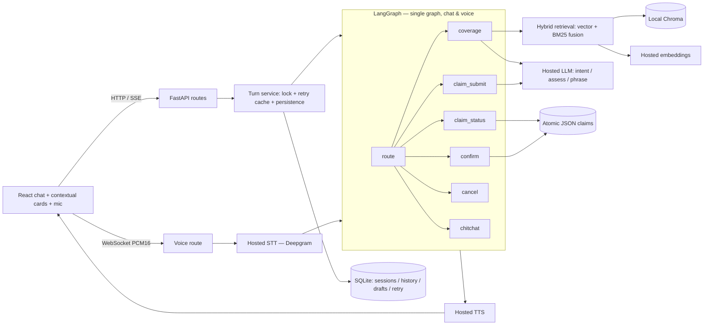

# OmniCare AI

An insurance customer-service assistant that answers coverage questions with
real policy citations, looks up claim status, and drafts and submits claims.
Every answer is backed by a **hosted** LLM (Google Gemini by default; OpenAI,
Anthropic, and OpenAI-compatible providers are also supported). There is no
local inference anywhere — if the configured provider's key is missing, the
backend fails fast at startup rather than falling back to a demo or offline
mode.

## How it works

- **Ownership starts with the browser.** An opaque, HttpOnly, same-site session
  cookie establishes who you are. Conversation and claim access is bound to that
  session, never to a caller-supplied user ID.
- **One workflow for chat and voice.** Every message — typed or spoken — runs
  through a single LangGraph workflow that routes to coverage, claim status,
  claim submission, confirmation, cancellation, or chitchat.
- **Evidence by hybrid retrieval.** Policy evidence is retrieved with combined
  semantic search and BM25 rank fusion over a locally-indexed Chroma store,
  using hosted embeddings (Gemini or OpenAI).
- **Structured verdicts, not prose.** A hosted LLM assesses the coverage question
  and returns a structured verdict with exact verified quotes from the policy.
  Those quotes are evidence provenance, not a guarantee that every interpretation
  is correct.
- **Claims are gated and deterministic.** A claim is drafted only after a
  coverage gate passes, and submitted only through an explicit structured
  confirm action. Validation, idempotency, and ownership checks are deterministic
  code — the LLM can never authorize a write.



## Why LangGraph

LangGraph was chosen over LangChain chains, CrewAI, and ADK because this
workflow is a **state machine, not a pipeline**. Coverage decisions branch
(coverage / claim status / submit / cancel / chitchat), and a claim may only be
submitted after a deterministic confirmation gate — those transitions must be
explicit code, never delegated to a model.

- **Explicit control flow.** Nodes and conditional edges are code. The hosted LLM
  only picks the intent and shapes structured outputs; every transition and side
  effect is fixed in the graph.
- **Typed state.** `AgentState` is a `TypedDict`, so each node reads and writes a
  single validated state object, and `graph.stream(mode="updates")` emits
  per-node updates that drive the SSE progress stream.
- **One graph, two transports.** The same compiled graph serves chat and voice,
  with no duplicated orchestration logic.
- **Structured outputs via tool calling.** Every model call uses a forced
  function schema generated from a Pydantic model, so outputs are validated
  types — never prose parsed with regex.
- **Deterministic, testable side effects.** Status lookup, submission,
  idempotency, and ownership are plain code behind the tools, keeping the model
  out of anything authoritative.

## Quick start

```bash
cp .env.example .env      # then add LLM_API_KEY (your Google AI Studio key)
docker compose up --build
```

Open **http://localhost:8080**. Add your Gemini key to `.env` as `LLM_API_KEY`
before starting — a missing key fails fast at startup, because inference is
hosted-only with no offline fallback. A Gemini key enables text chat and policy
search; optional voice requires a separate Deepgram (and TTS) key.

## Sample requests (curl)

Create a session first and capture its cookie (the chat endpoint requires it):

```bash
curl -c cookies.txt -X POST http://localhost:8000/api/v1/session
# -> {"user_id":"usr_..."}   (also sets the `omnicare_session` cookie)
```

Health check:

```bash
curl http://localhost:8000/api/v1/health
# -> {"status":"healthy","mode":"live","providers":{...}}
```

Coverage question (policy citations in `sources`):

```bash
curl -b cookies.txt -X POST http://localhost:8000/api/v1/chat \
  -H 'Content-Type: application/json' \
  -d '{"user_id":"usr_...","message":"Is water damage from a burst pipe covered?"}'
```

Claim status (tool call recorded in `tool_calls`):

```bash
curl -b cookies.txt -X POST http://localhost:8000/api/v1/chat \
  -H 'Content-Type: application/json' \
  -d '{"user_id":"usr_...","message":"What is the status of claim CLM-8821?"}'
```

Submit a claim — draft, then confirm with an explicit structured action:

```bash
curl -b cookies.txt -X POST http://localhost:8000/api/v1/chat \
  -H 'Content-Type: application/json' \
  -d '{"user_id":"usr_...","message":"I need to file a water damage claim for $3,500"}'

curl -b cookies.txt -X POST http://localhost:8000/api/v1/chat \
  -H 'Content-Type: application/json' \
  -d '{"user_id":"usr_...","message":"confirm","action":"confirm_submit","draft":{"policy_number":"POL-1092","claim_type":"Water Damage","amount":3500,"description":"Burst pipe in the kitchen"}}'
```

`user_id` must match the session owner returned by `/api/v1/session`. Full
request/response shapes are in [API contracts](docs/CONTRACTS.md).

## Documentation

- [Architecture](docs/ARCHITECTURE.md) — components, turn flow, and safety boundaries
- [Setup and configuration](docs/SETUP.md) — providers, embeddings, and voice
- [Evaluation](docs/EVALUATION.md) — how quality is measured
- [API contracts](docs/CONTRACTS.md) — endpoints, request/response shapes, and SSE frames
- [Walkthrough](docs/WALKTHROUGH.md) — step-by-step UI verification script
