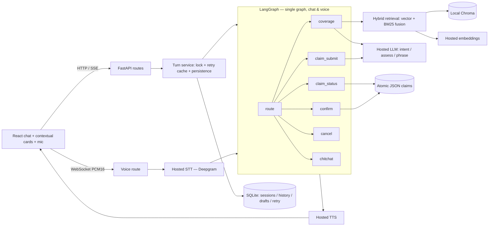
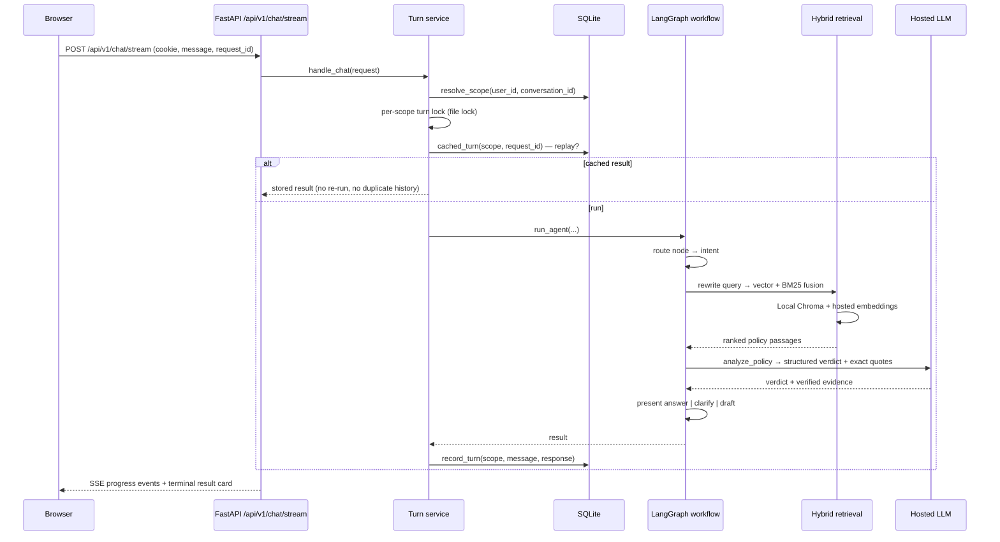

# OmniCare AI — Architecture

## Overview

OmniCare AI is a hosted-only insurance customer-service assistant. A React +
TypeScript + Vite + Tailwind frontend talks to a FastAPI backend. Each request is
handled by a serialized turn service that runs one shared LangGraph workflow over
the message — the same graph serves both typed chat and the optional voice
pipeline. Policy evidence is retrieved with hybrid semantic + BM25 search over a
local Chroma index (populated with hosted embeddings), and a hosted LLM turns that
evidence into a structured coverage verdict with exact verified quotes. Claims are
drafted only after a coverage gate and written only through an explicit structured
confirmation; every validation, idempotency, and ownership check is deterministic
code. State lives in SQLite (sessions, conversations, history, drafts, retry
results) plus a file-locked, atomic JSON claim store.

## System flow

## One chat turn

The graph routes on intent (`coverage`, `claim_status`, `claim_submit`,
`confirm`, `cancel`, `chitchat`). Coverage turns rewrite the query, retrieve
passages by fused vector + BM25 ranking, and ask the hosted LLM for a structured
verdict with `cited_ids` and exact quotes; the verdict is then phrased, clarified,
or converted into a claim draft. Confirmation never re-derives authorization from
the model — it re-runs the coverage gate and then performs deterministic
validation, idempotent submission, and persistence.

## Components

| Module | Responsibility |
|---|---|
| `backend/app/main.py` | FastAPI app, lifespan startup (policy ingestion + fail-fast credential checks), CORS, request-ID middleware, and the `/session`, `/health`, `/conversations`, `/chat`, and `/chat/stream` routes. |
| `backend/app/service.py` | Serialized turn handling: scope resolution, per-scope file lock, retry-cache replay, agent invocation, and atomic history + result persistence. |
| `backend/app/agent/graph.py` | Builds the single `StateGraph` (`route` → intent → leaf nodes) and exposes `run_agent`, the shared entry point for chat and voice. |
| `backend/app/agent/nodes.py` | Per-intent node implementations: routing, coverage assessment, claim status lookup, draft/gate, deterministic confirm, cancel, and chitchat. |
| `backend/app/agent/state.py` | `AgentState` shape, `build_response`, and draft ⇄ payload / missing-field helpers shared across nodes. |
| `backend/app/agent/retrieval.py` | `assess_policy`: orchestrates query rewrite, hybrid retrieval, and the LLM verdict-with-evidence assessment. |
| `backend/app/agent/llm.py` | Hosted LLM client and structured-output helpers: intent classification, query rewrite, policy assessment, answer composition, claim-field extraction, and claim selection. |
| `backend/app/rag/pipeline.py` | Hybrid retrieval pipeline: vector + BM25 rank fusion, index management, and content-change reingestion. |
| `backend/app/rag/chunking.py` | Splits Markdown / plain-text policy documents into overlapping chunks. |
| `backend/app/rag/embeddings.py` | Hosted embedding provider abstraction (Gemini / OpenAI), including index identity by endpoint/model. |
| `backend/app/rag/vectorstore.py` | Local Chroma vector store management, with index isolation by embedding identity. |
| `backend/app/claims/store.py` | Atomic JSON claim store: exclusive file lock, temp-file + `os.replace` writes, deterministic idempotent claim IDs, and ownership visibility. |
| `backend/app/claims/tools.py` | `SubmitClaimInput` Pydantic schema and claim tool definitions. |
| `backend/app/db.py` | SQLite persistence: `sessions`, `conversations`, `turn_results`, `messages`, `drafts`; session issuing, scope resolution, and retry-cache access. |
| `backend/app/session.py` | Session authentication: opaque HttpOnly `omnicare_session` cookie (or bearer token) → owner, with origin checks. |
| `backend/app/voice/route.py` | WebSocket voice endpoint: cookie-authenticated PCM16 audio → Deepgram STT → the same workflow → hosted TTS back, with interim transcripts. |

## Safety boundaries

The design keeps every write, authorization, and identity decision in
deterministic code and treats hosted model output as untrusted input:

- **The LLM never authorizes a write.** The model can phrase, assess, and
  extract, but it cannot submit a claim or change the structured verdict.
- **Explicit structured confirmation.** A claim is only written via the
  `confirm_submit` action, validated by `SubmitClaimInput`, after the reviewed
  incident is re-checked against the coverage gate (so edits can't bypass it).
- **Idempotent, owner-scoped claim IDs.** Claim IDs derive deterministically from
  the (policy, type, amount, description) tuple plus the owner, so retries and
  double-submits yield the same claim and never create duplicates.
- **Ownership before embedding.** Candidate claims are filtered by ownership
  *before* any embedding or model selection, so unowned records are never exposed
  (except the two public sample records).
- **Hosted-only, fail-fast.** There is no local or rule-based fallback; a missing
  provider key stops startup rather than degrading silently.
- **Evidence is provenance, not proof.** Exact quotes are verified against the
  retrieved source text, but generated paraphrases and interpretations remain
  fallible.
- **Retry replays without duplication.** A stored request ID replays the original
  result; a different body under the same ID returns `409`, and retries never
  append duplicate conversation messages or claims.

## Data & persistence

**SQLite** (via `backend/app/db.py`) holds five tables:

- `sessions` — token hash → owner, with an expiry; the source of the opaque
  30-day browser session.
- `conversations` — owned conversation id, title, and last-updated timestamp.
- `turn_results` — `(scope, request_id)` → body hash and serialized response, the
  retry/replay cache.
- `messages` — per-scope message history (role, content, type, and data JSON).
- `drafts` — the in-progress claim draft per user (policy number, type, amount,
  description).

**Claims** live in a single JSON array (`backend/app/claims/store.py`). Writes
are serialized under an exclusive file lock, written to a temp file, `fsync`'d,
and atomically `os.replace`d into place. The two public sample records
(`CLM-8821` and `CLM-9014`) are visible to everyone; every other record carries an
`owner_id` and is visible only to its creating session.
