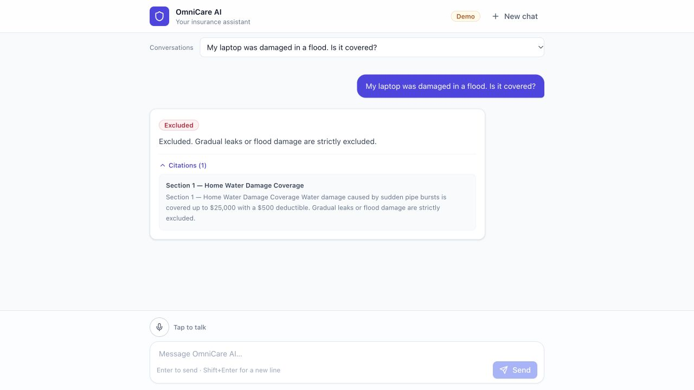

# OmniCare walkthrough

Start with `docker compose up --build` and open http://localhost:8080.
The browser establishes a session automatically. A valid LLM key is required:
the backend fails fast at startup without one (there is no demo or offline mode).

1. Ask **“My laptop was damaged in a flood. Is it covered?”** Check the exclusion
   and expand its policy citation. A property category must not override a relevant
   cause-of-loss exclusion.
2. Ask **“I have water damage. Am I covered?”** Check that the assistant asks for
   the cause instead of assuming a pipe burst.
3. Start **New chat**. It should be empty. Select the earlier conversation from
   **Conversations** and verify that the answer and citation return; refresh and
   verify the same session can resume it.
4. Ask **“What happened to my laptop claim?”** Inspect the matching claims and
   select one to check its status. The assessment records are shared sample data;
   newly created claims belong only to their browser session.
5. Describe a new claim with policy number, type, amount, and incident details.
   An LLM-driven coverage gate flags excluded, unsupported, or uncertain perils
   before a draft is shown. Edit the review card, then explicitly submit. Verify
   a confirmation ID. A new chat must not inherit the previous chat's draft.
6. If the connection fails, use **Retry**. The original request ID is reused to
   recover the response without duplicate conversation messages or claims.

Progress is streamed while work runs; complete response cards are shown atomically.
Citation similarity scores are not displayed as confidence percentages.

Verified: mixed-exclusion answer, new conversation, restored history and
citation display. Automated tests additionally cover retry, ownership, policy
updates, draft separation, and malformed/fabricated hosted evidence.

Gemini chat and embeddings were separately smoke-tested with HTTP 200 responses.
The full hosted evaluation and optional voice pipeline are separate checks.
